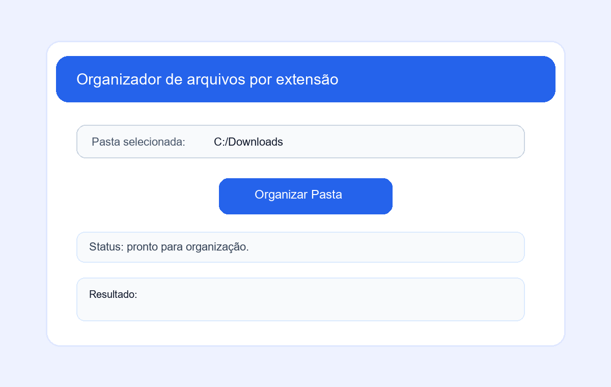

# Organizador de Pasta

Projeto em Python para organizar arquivos de uma pasta em subpastas com base na extensão do arquivo.

## Visão geral
O script percorre a pasta selecionada, identifica os tipos de arquivos e os move automaticamente para categorias como imagens, documentos, vídeos, músicas, compactados, programas e outros.

## Funcionalidades implementadas

✅ Seleção da pasta via janela gráfica com Tkinter

✅ Criação automática das pastas de organização

✅ Organização por extensão de arquivo

✅ Tratamento de nomes duplicados para evitar sobrescrita

✅ Exibição do resultado na própria interface

✅ Mensagem de erro para pasta inválida

## O que não está implementado

⚠️ Não há backup automático antes da movimentação

⚠️ Não há opção de desfazer a organização

⚠️ Não há filtro por tamanho, data ou extensão personalizada

⚠️ Não há suporte para organizar múltiplas pastas em uma única execução

## Estrutura de organização

- Imagens/
- Documentos/
- Vídeos/
- Músicas/
- Compactados/
- Programas/
- Outros/

## Como usar

1. Abra o arquivo `# Organizar Pasta.py`
2. Execute com Python
3. Clique em `Selecionar`
4. Escolha a pasta a ser organizada
5. Clique em `Organizar Pasta`

## Preview da interface

## Observações

Este projeto foi validado com a checagem de sintaxe do Python e a interface foi ajustada para ficar mais clara e profissional. O objetivo principal é organizar arquivos de forma simples e rápida no computador.

## Desenvolvedor

Leanderson Viana
